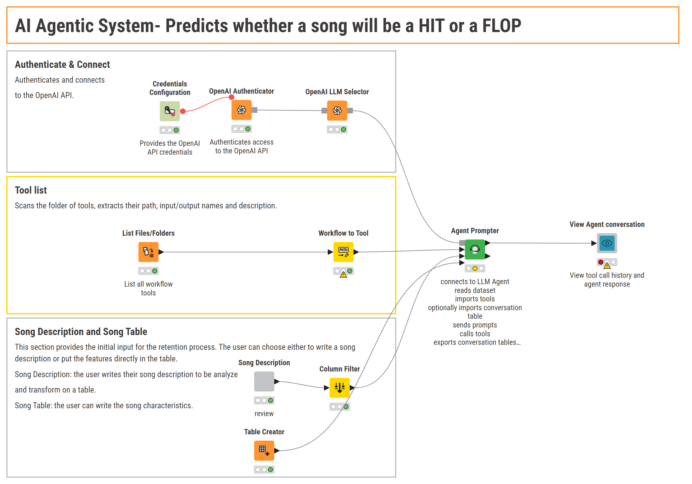
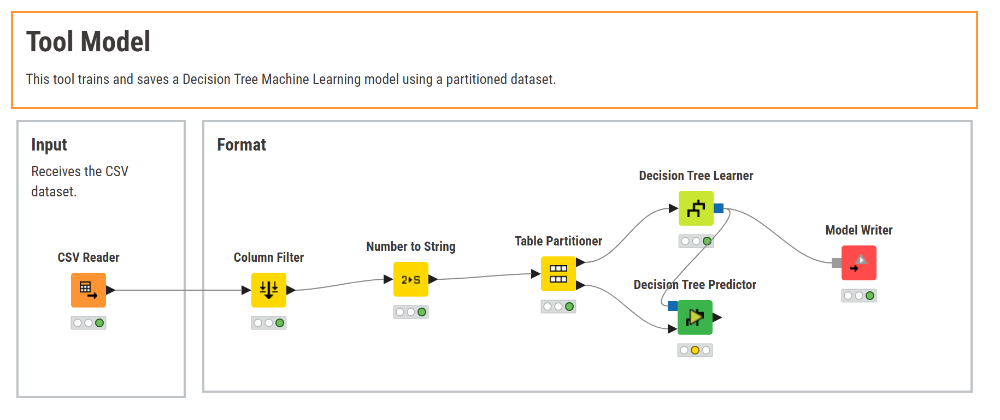
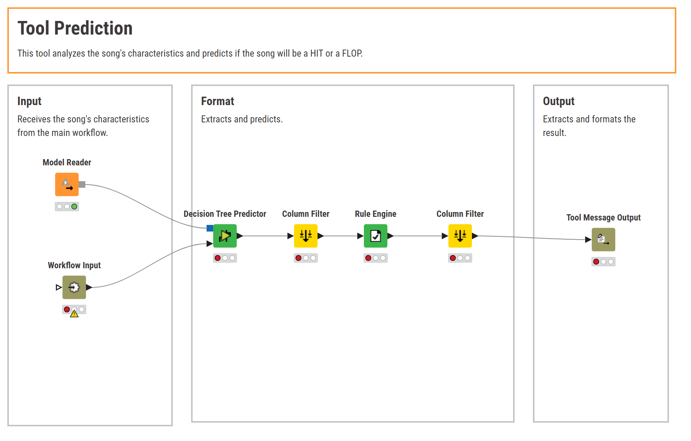
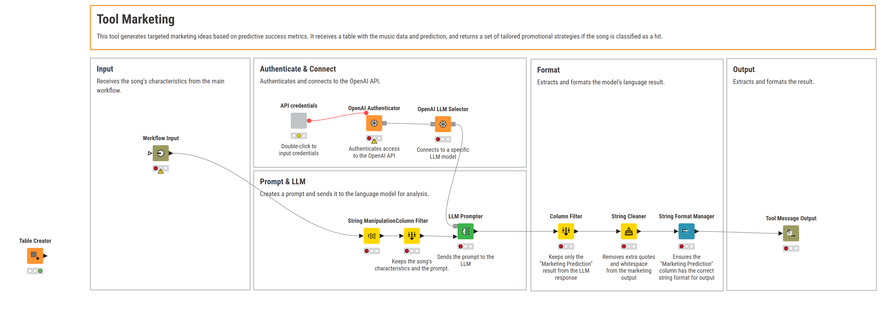
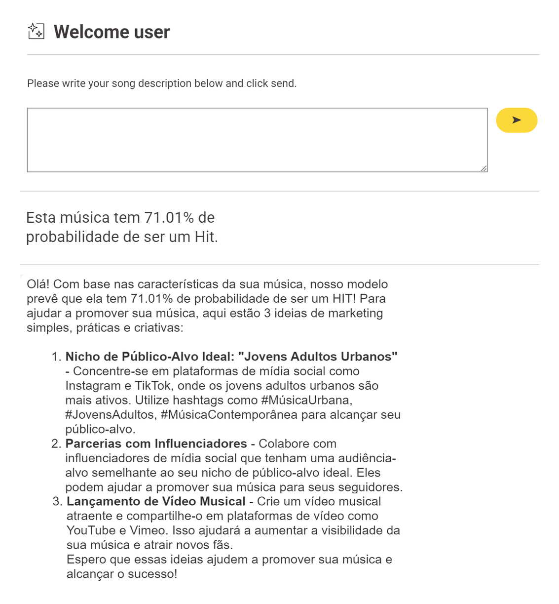
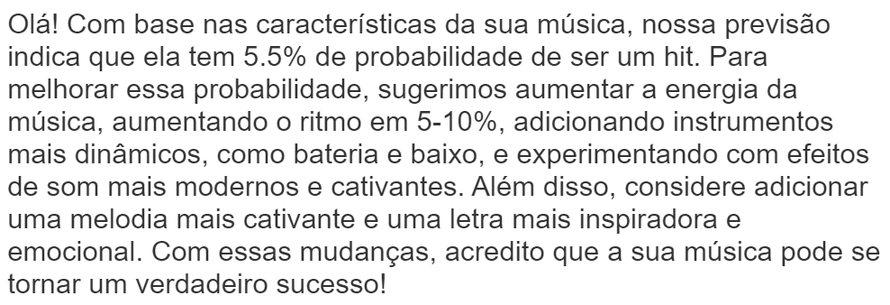

# AI Music Hit Predictor & Creative Advisor Agent

An **agentic AI system** built in KNIME that combines a classical Machine Learning classifier with a Large Language Model (`Llama 3.3 70B` via the Groq API) to predict whether a song will be a **HIT or a FLOP**, and then gives marketing or production advice in natural language.

The user can either describe a song in free text ("a fast, very danceable acoustic track...") or type its audio features directly into a table. The LLM agent decides which tools to call, runs the trained model, and writes the final answer.

## How it works

The main workflow (`music`) wires an **Agent Prompter** node to an LLM and to a folder of tool workflows. KNIME's *Workflow to Tool* node turns each tool workflow into a function the agent can call on its own:

| Tool | What it does |
|------|--------------|
| **Prediction** (`tool_prediction`) | Loads the trained Decision Tree and classifies the song as Hit / Non-Hit from its audio features. |
| **Confidence** (`tool_confidence`) | Returns the model's class probability, i.e. how sure it is about the prediction. |
| **Marketing** (`tool_marketing`) | If the song is predicted as a hit, asks the LLM for targeted promotion ideas based on its profile. |
| **Improvements** (`tool_improvements`) | If the song is predicted as a flop, asks the LLM for production changes that could move it toward hit patterns. |

The classifier itself is trained in a separate workflow (`tool_model`): CSV Reader → Column Filter → Table Partitioner → **Decision Tree Learner** → Decision Tree Predictor → Model Writer.

Sub-workflow screenshots

**Model training**

**Prediction tool**

**Marketing tool (LLM-based)**

## Example interaction

The user writes a song description; the agent calls the prediction and confidence tools, then the marketing tool, and answers (in Portuguese, the language of the prompt):

When the prediction is a flop, the agent calls the improvements tool instead:

## Tech stack

* **Workflow & orchestration:** KNIME Analytics Platform (AI Extension: Agent Prompter, Workflow to Tool)
* **Machine Learning:** supervised binary classification with a Decision Tree
* **LLM:** `llama-3.3-70b-versatile` served by Groq through its OpenAI-compatible API
* **Data:** Spotify audio features (danceability, energy, loudness, tempo, valence, acousticness, ...) for tracks from the 1960s to the 2010s

## Repository structure

* `architecture_workflow.png` — Main agent workflow.
* `demo_interaction.png` — Real run: song input, predicted hit probability and marketing advice.
* `images/` — Sub-workflow screenshots and the "flop" example.

## Workflow file

Because this was a university assignment that may be reused in future editions of the course, the KNIME workflow file (`.knar`) is not published here. **It is available on request**: feel free to contact me via [LinkedIn](https://www.linkedin.com/in/margarida-carvalho-7b11293b8).

The model was trained on the [Spotify Hit Predictor dataset](https://www.kaggle.com/datasets/theoverman/the-spotify-hit-predictor-dataset) (Kaggle).

## Academic context & attribution

Developed as a group project for the course *Elements of Artificial Intelligence and Data Science* (EIACD), 1st year of the BSc in Artificial Intelligence and Data Science at the Faculty of Sciences, University of Porto (FCUP).

Developed by **Margarida Carvalho** in collaboration with Leonor Carvalho and Maria Cabral.

Parts of the agent setup (authentication and tool-list sections) were adapted from KNIME's official AI agent example workflows; the tools, model, prompts and overall design are our own.
